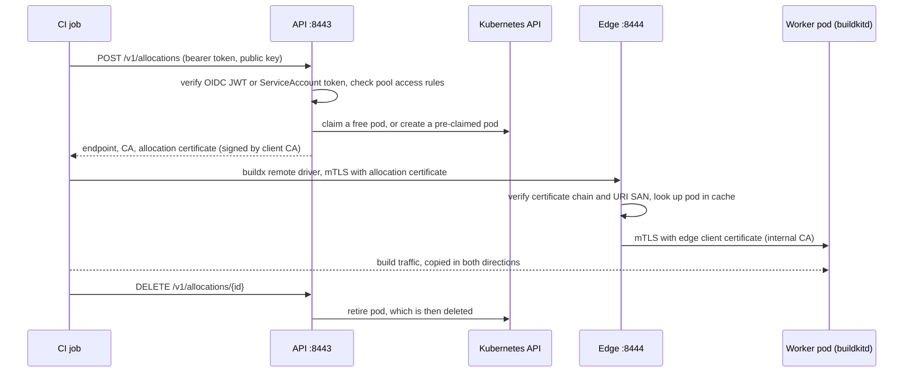

# Architecture

This page is the short version of how the controller works. Day-two tasks are in [operations.md](operations.md) and a first install is in [quickstart.md](quickstart.md).

## One binary, three roles

The `buildkit-controller` binary (`crates/server`) runs as one Deployment with two replicas by default. Every replica runs these roles.

| Role | Port | Job | Runs on |
|---|---|---|---|
| API | 8443 (HTTPS) | Authenticates callers, picks a worker, issues an allocation certificate | every replica |
| Edge | 8444 (mTLS) | Proxies a build connection to its worker | every replica |
| Reconciler | none | Keeps warm pods, retires expired ones, manages CAs and worker certificates, writes status | the Lease holder only |

Clients reach the API and edge ports through a Gateway by default: the API through an HTTPRoute, where the gateway terminates TLS and re-encrypts to the controller, and the edge through a TLS passthrough TLSRoute, so that the edge itself checks the client certificate. A LoadBalancer Service is the alternative. See [Exposure](operations.md#exposure).

A separate ops port (8080, plain HTTP, on its own ClusterIP Service) serves `/healthz`, `/readyz` and `/metrics`. All replicas share in-memory watch caches of pools and pods, so the API and edge read pools and pods from memory. On the request path the API calls the Kubernetes API only for TokenReview (ServiceAccount tokens), to create pre-claimed pods, and to patch pods when it claims or retires them.

## One CRD

`BuildKitPool` (`buildkit.smrt-devops.net/v1alpha1`, namespaced, short name `bkp`) is the only custom resource. A pool declares platforms, a pod template, scaling bounds and schedule, allocation TTLs and queue limits, egress rules, and access rules. One install serves any number of pools, like ARC runner scale sets. The field reference is the generated CRD, [buildkitpools.yaml](../helm/buildkit-controller/crds/buildkitpools.yaml), and `kubectl explain bkp.spec` prints the same descriptions.

## Pods are the workers

There is no worker CRD and no gateway. The reconciler creates plain pods named `<pool>-<slot>` and owns them by label. A pod is `free`, `allocated` or `draining`. Claiming a free pod is one JSON patch with a test on its labels, so two replicas cannot claim the same pod. If no pod is free, the API creates a pre-claimed pod while the pool is under `scaling.max`, and otherwise queues the request. Retiring a pod is also a patch, followed by deletion. The pod template is yours, but the controller owns the security context, TLS mounts, command and labels. The API server rejects a template that sets those.

Each replica keeps one first-in, first-out queue per pool. A request that finds the queue non-empty goes to the back without trying for a pod itself, so a newcomer cannot take a freed pod from a request that has waited longer on the same replica. A request with `queueTimeoutSeconds: 0` that finds others waiting fails at once with `pool_exhausted`. Order across replicas is best effort: replicas do not share a queue, so a request on one replica can take a pod freed while another replica has waiters. Every replica writes its queue length to the pool's `status.waiters`. The leader keeps at least that many pods free or starting, up to `scaling.max`, so below `max` the waiters on every replica get pods. At `max`, the replicas race for each freed pod.

A claim first holds the pod only briefly. Its `expires-at` is 60 seconds past the moment the pod can be ready: the claim itself for a free pod, the end of `workers.startTimeout` for a created one. Just before the API answers, it moves `expires-at` to the allocation's real expiry with a patch that tests the short value. If that patch fails, the request fails and the pod is retired. A replica killed between the claim and the answer therefore holds the pod for at most `startTimeout` plus 60 seconds, after which the reconciler retires it as expired. The claim always ends before the real expiry, so every commit changes `expires-at`. The reconciler's expiry and start-timeout retires of an allocated pod test the `expires-at` they judged, so neither can reap an allocation that committed in the meantime.

A new pod is created before its worker Secret, and the Secret is created with the pod as its owner, so the garbage collector deletes it with the pod and no other object ever owns a worker's private key. A pod whose Secret was never created cannot mount it, never becomes ready, and is retired at `startTimeout`. When the answer to a pod create is lost, the controller reads the pod back and creates the Secret only if the pod exists.

## Data path



The allocation certificate's URI SAN names the pod, the allocation and the pool. The edge reads those fields and finds the pod in its watch cache, so it needs no database and no per-request call to Kubernetes. When the allocation is released, expires, or the pod disappears, the edge closes its connections.

## Two CAs

The CA Secret holds two CAs. The client CA signs allocation certificates and the self-issued edge and API serving certificate. The internal CA signs the worker serving certificates and the edge-to-worker client certificate. buildkitd trusts only the internal CA, so an allocation certificate cannot talk to a worker directly.

## Worker identity

Each worker pod has its own serving certificate, issued by the internal CA. Its only name is `<nonce>.<pod>.<pool>.<namespace>.worker.buildkit.internal`, where `<pod>` is the slot name `<pool>-<slot>` and `<nonce>` is 16 random hex characters picked before the pod is created and stored on the pod. Slot names are reused, so the nonce is what tells two pods of one slot apart. The edge dials the worker using the name of the pod it looked up for the allocation. A different pod, or an earlier pod of the same slot, holds a certificate for another name, so the handshake fails and a connection can never be steered to the wrong worker. A pod is never renewed. The reconciler retires a free pod whose certificate has under 25 hours left, and a pod created on demand gets a certificate that lasts until its allocation expires plus 5 minutes.

## Allocation owner

Every allocation records its caller as the owner, and only the same owner can release it early. A service account is `sa:<namespace>/<name>` and a claim is `claim:<namespace>/<name>#<uid>`. An OIDC caller is `oidc:<iss>#<sub>`, plus the run claims `run_id`, `run_attempt` and `job_workflow_ref` when the token carries them, as `#run_id=<value>` and so on, with `%` and `#` in `sub` and in each value percent-encoded. GitHub Actions tokens carry all three. Their `sub` alone is the same for every run of a repository and ref, and for every `pull_request` run, so without the run claims one run could release another's worker. A token from the same job, such as the one the Action fetches in its post step, gives the same owner. A re-run attempt is a different owner and cannot release the earlier attempt's worker, which ends at its expiry.

## Build cache

Each allocation gets its own worker pod, and the pod is deleted when the allocation ends. Cache comes from the pool's two layers, set under `spec.workers.cache`. Both are off by default.

- The registry layer (`cache.registry`) is the one to rely on. The allocation response carries buildx `--cache-to` and `--cache-from` values for the request's cache key, built from `repository`, the `ref` template, `mode` and `importFrom`. Every build of a key imports the same ref and exports to it, so ten concurrent builds all read the cache, and the last export to finish becomes the ref. The controller holds no registry credentials. Buildx sends the client's own credentials, so grant push on the cache repository to your CI identities. A client that does not pass the returned flags builds without this layer.
- Local volumes (`cache.local`) keep a worker's whole buildkitd state directory on a PVC `<pool>-cache-<slot>`. That directory holds the content store, the cache records and every image built there. A volume belongs to one slot and one pod uses it at a time, so it speeds up only the build that lands on that slot. `maxVolumes` caps how many slots have a volume, and `affinity: soft` prefers a slot whose volume last served the same key. Affinity never makes a request wait.

A request picks its key with `cacheKey` (1 to 63 characters, default the pool's `registry.defaultKey`, else the pool name) and its layers with `cache`: `auto` (every layer the pool enables), `registry`, `local` or `none`. Asking for a layer the pool lacks is a 400.

`local.result` in the response and the allocation metric report how the slot matched: `hit` (the volume served this key before), `spill` (a volume of the caller's scope that served the key was busy, so another slot was used), `miss`, `cold` (the pod was created for this request), `wiped` (the pod was created for this request on a volume that belonged to another cache scope, so it started empty) or `uncached` (the slot has no volume). `spill` is normal when builds of one key overlap, and that build still gets the registry cache. A pool that runs concurrent builds of one repository should set the registry layer.

### Who shares a local volume

Each volume belongs to one cache scope. `cache.local.scope` sets how scopes are drawn:

- `identity`, the default, gives each caller its own scope. An OIDC token with a `repository_id` claim (GitHub Actions) is scoped to that repository id, one with only a `repository` claim to that name, and any other OIDC token to its `sub`. The token's issuer is always part of the scope. A ServiceAccount is scoped to its namespace and name, and a `BuildKitClaim` to its namespace. Every run, branch and pull request of one repository shares that repository's scope.
- `pool` puts every caller the pool admits in one scope. Use it only when the pool's access rules admit a single trust domain.

Within a scope everything in the state directory is shared: cache records, layers and the images built there. A later build of the same scope can read them through BuildKit's API, the content store included. Nothing crosses scopes:

- The volume's `buildkit.smrt-devops.net/cache-scope` annotation names the scope that owns its contents and a generation id. A file in the volume holds the same id.
- A pod in a cached slot is bound to one scope when it is created. A warm pod takes the volume's scope, and a pod created for a request takes the caller's. Before buildkitd starts, the `cache-init` init container compares the file with the generation the pod was bound to. If they differ, or the pod was bound to a scope that does not own the volume, it deletes everything in the state directory. A volume with no owner is emptied the same way, and the pod that starts on it can serve any scope. The file decides, not the annotation, so a lost or late annotation write costs a cache miss and never exposes another scope's data.
- A warm pod bound to another scope is never offered to a request. When a request finds no pod and no free slot, and nothing is starting or terminating, the allocator clears the owner of one such pod's volume and retires the pod. The slot's next pod then starts empty and serves any scope.

Pools with `cache.local` run buildkitd with `[history] maxEntries = 0`, which turns off BuildKit's build history, and `cache-init` also deletes `history.db`. Build records hold logs, build arguments and provenance, so a later allocation must not read them through the history API. `buildx history` and the build record export of `docker/build-push-action` therefore find nothing on these pools. Pools without `cache.local` keep history on the pod's `emptyDir`, which is deleted with the pod.

The registry layer is not scoped. Every caller the pool admits can pass any `cacheKey`, and anyone with push access to the repository can write the refs, so cache written there can be read and overwritten by all of them. Enable the registry layer only on pools whose access rules admit one trust domain.

## BuildKitClaim

`BuildKitClaim` (`buildkit.smrt-devops.net/v1alpha1`, namespaced, short name `bkc`) is a second, opt-in CRD for in-cluster pipelines such as Tekton or Argo. Instead of calling the HTTP API, a pipeline creates a claim and reads the credentials from a Secret. It is off by default (`claims.enabled`, see [operations.md](operations.md#in-cluster-claims)).

```yaml
apiVersion: buildkit.smrt-devops.net/v1alpha1
kind: BuildKitClaim
metadata: {name: build-42, namespace: ci}
spec:
  poolRef: {namespace: buildkit, name: default}
  ttl: 30m          # optional, the pool's allocation.defaultTTL when unset
  cacheKey: app-main   # optional, same meaning as in the API
  cache: auto          # optional: auto, registry, local or none
```

The spec is immutable, so a different builder is a different claim. The claim controller runs on the leader and allocates through the same engine and the same pool queue as the API. The pool must admit the claim with an access rule `claims: {namespaces: [...]}`. A claim's identity is its namespace, name and UID, which the API server sets, so a tenant cannot forge another namespace. A claim for a pool that is missing or does not admit its namespace fails the same way, with reason `PoolNotFound`.

When the worker is ready the controller creates a Secret `<claim>-buildkit` owned by the claim with `tls.crt`, `tls.key`, `ca.crt` (omitted when the edge uses public roots), `endpoint` and `server-name`, and sets `status.phase` to `Bound`. A claim ends as `Expired` at `status.expiresAt` or `Lost` if its worker pod disappears (the controller does not rebind it). A claim that cannot be served is `Failed`. All three are final: delete the claim and create a new one. Deleting a claim deletes its Secret, and the controller releases the worker within a few seconds.


## Failure handling

If the leader dies, another replica takes the Lease within the lease duration (15 s by default), and API and edge traffic on other replicas continues. A stopping replica releases the Lease first, so leadership moves within seconds. After `shutdown.delay` (5 s), which lets endpoints converge, it closes the API listener and answers queued allocation requests with 503 `shutting_down` before claiming anything. The edge then stops accepting and keeps each open connection until it ends on its own (release, expiry, worker gone, certificate `notAfter`), at most 24h5m unless `shutdown.drainTimeout` caps it. Rollouts, scale-in and node drains therefore do not cut running builds; see [Stopping a replica](operations.md#stopping-a-replica).
