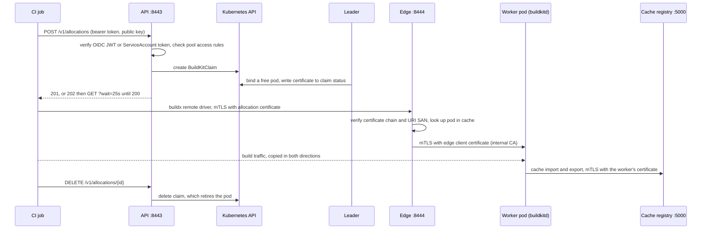

| Registry (`buildkit-controller registry`) | 5000 (mTLS), 8080 (ops) | Stores BuildKit cache for the workers | one StatefulSet pod |# Architecture

This page is the short version of how the controller works. Day-two tasks are in [operations.md](operations.md) and a first install is in [quickstart.md](quickstart.md).

## One binary, four roles

The `buildkit-controller` binary (`crates/server`) runs as one Deployment with two replicas by default. Every replica runs three roles. A fourth, the cache registry, runs as its own single pod from the same binary.

| Role | Port | Job | Runs on |
|---|---|---|---|
| API | 8443 (HTTPS) | Authenticates callers, creates and reads allocation claims, answers with the certificate once a claim is bound | every replica |
| Edge | 8444 (mTLS) | Proxies a build connection to its worker | every replica |
| Reconciler and allocator | none | Keeps warm pods, binds queued claims to pods, signs allocation certificates, retires expired pods, manages CAs and worker certificates, writes status | the Lease holder only |
| Cache (`buildkit-controller cache`) | 5000 (mTLS), 8080 (ops) | Stores BuildKit cache for the workers | one StatefulSet pod |

Two names stay apart in this project. "Cache" is the user feature: the Helm values `cache.*`, the pool field `spec.workers.cache` and the `cache` field of an allocation. "Registry" is the component that stores it: the `registry` role, the `<fullname>-registry` objects and the `buildkit_registry_*` metrics.

Clients reach the API and edge ports through a Gateway by default: the API through an HTTPRoute, where the gateway terminates TLS and re-encrypts to the controller, and the edge through a TLS passthrough TLSRoute, so that the edge itself checks the client certificate. A LoadBalancer Service is the alternative. See [Exposure](operations.md#exposure).

A separate ops port (8080, plain HTTP, on its own ClusterIP Service) serves `/healthz`, `/readyz` and `/metrics`. All replicas share in-memory watch caches of pools, claims and pods, so the API and edge read from memory. The API replicas hold no queue and sign nothing. They authenticate the caller, check the pool's access rules, and write or read a claim.

## Two CRDs

- `BuildKitPool` (`buildkit.smrt-devops.net/v1alpha1`, namespaced, short name `bkp`) declares platforms, a pod template, scaling bounds and schedule, allocation TTLs and queue limits, egress rules, cache settings and access rules. One install serves any number of pools, like ARC runner scale sets. The field reference is the generated CRD, [buildkitpools.yaml](../helm/buildkit-controller/crds/buildkitpools.yaml), and `kubectl explain bkp.spec` prints the same descriptions.
- `BuildKitClaim` (short name `bkc`) is one request for one worker. Every allocation is a claim, whether it comes from CI over HTTP or from a pipeline in the cluster. See [BuildKitClaim](#buildkitclaim).

There is no worker CRD and no cache CRD.

## The claim queue

An allocation is a `BuildKitClaim` that waits to be bound to a pod. The claims of a pool, oldest first, are its queue.

1. `POST /v1/allocations` authenticates the caller, checks the pool's access rules and creates a claim in the controller's own namespace. The claim is named after the allocation id, which is derived from the request's public key, and carries that key and the caller's identity. A repeated `POST` with the same key from the same caller finds the existing claim and answers for it, so the request is idempotent and a client that lost the answer sends it again. The same key from another caller gets `403`. Tenants have no write access to that namespace, and the controller honours a written `owner` only there, so a tenant cannot pass as a CI identity.
2. The API waits up to 20 seconds for the claim to bind. Bound in time, it answers `201` with the endpoint, the CA and the allocation certificate. This is the warm-pod path, one round trip. Otherwise it answers `202` with `{"id", "state": "pending", "position"}`.
3. The client then calls `GET /v1/allocations/{id}?wait=25s`. The call returns `200` with the full response once the claim is bound, `202` while it is pending, and the error JSON if the claim failed. Any replica can answer, because the state is the claim. A client that loses its connection polls again and keeps its place. No request stays open longer than 25 seconds, which is under the idle timeout of every common gateway and load balancer.
4. `DELETE /v1/allocations/{id}` deletes the claim after an owner check, and the leader retires the pod.

### The leader allocator

The Lease holder runs one loop per pool. It takes the pool's pending claims in order of `creationTimestamp`, which the API server sets, so no replica can jump the queue, and breaks ties by name. Each claim gets a free pod. If none is free and the pool is under `scaling.max`, the reconciler creates pods for the waiters. A claim still pending at its queue timeout becomes `Failed` with reason `QueueTimeout`, and the client sees `503 pool_exhausted`.

Binding is two writes, in this order:

1. A JSON patch on the pod that tests the pod's labels and sets the allocation annotations, including the claim. The test makes a double booking fail, so a deposed leader cannot claim a pod that the new leader already gave away.
2. The claim's status: `Bound`, the pod, the expiry and the certificate. The write carries the claim's `resourceVersion`.

A claim from the API holds the caller's public key, so the leader signs the allocation certificate for it and writes the certificate into the status. The private key never reaches the cluster. A claim without a public key, which is what an in-cluster pipeline creates, gets a key the leader generates and a Secret `<claim>-buildkit` that holds it.

Every 2 seconds the leader also tidies up: it expires bound claims at their TTL, marks claims whose pod is gone as `Lost`, deletes finished CI claims 10 minutes after they end, and retires pods whose claim is gone or ended. So `kubectl get bkc -A` shows recent history without growing forever, and a deleted claim never leaks a worker. `status.waiting` on the pool is the exact number of pending claims, and the reconciler sizes the pool from it.

A claim lives in the API server, so a replica restart loses nothing. When the leader dies, binding pauses until another replica takes the Lease (15 seconds by default). On a rollout the old leader releases the Lease at once. Pending claims are never lost.

## Pods are the workers

The reconciler creates plain pods named `<pool>-<slot>` and owns them by label. A pod is `free`, `allocated` or `draining`. Retiring a pod is a patch, followed by deletion. The reconciler force-deletes any owned pod that is still terminating 2 minutes after its grace period ended. The pod template is yours, but the controller owns the security context, TLS mounts, command and labels. The API server rejects a template that sets those. Workers have no volumes: the buildkitd state directory is an `emptyDir` that goes away with the pod.

A new pod is created before its worker Secret, and the Secret is created with the pod as its owner, so the garbage collector deletes it with the pod and no other object ever owns a worker's private key. A pod whose Secret was never created cannot mount it, never becomes ready, and is retired at `startTimeout`. When the answer to a pod create is lost, the controller reads the pod back and creates the Secret only if the pod exists.

## Data path



The allocation certificate's URI SAN names the pod, the allocation and the pool. The edge reads those fields and finds the pod in its watch cache, so it needs no database and no per-request call to Kubernetes. When the allocation is released, expires, or the pod disappears, the edge closes its connections.

Behind a gateway, the API and edge connections come from the gateway. With PROXY protocol on for a listener, the gateway prefixes each connection with the client's address, the controller reads that header before TLS from trusted gateway addresses only, and the per-address caps and logs use the client's address. See [PROXY protocol](operations.md#proxy-protocol).

## Two CAs

The CA Secret holds two CAs. The client CA signs allocation certificates and the self-issued edge and API serving certificate, and the workers' clientAuth-only registry leaves. The internal CA signs the worker serving certificates, the cache registry's serving certificate and the edge-to-worker client certificate. buildkitd trusts only the internal CA, so an allocation certificate cannot talk to a worker directly.

## Worker identity

Each worker pod has its own serving certificate, issued by the internal CA. Its only name is `<nonce>.<pod>.<pool>.<namespace>.worker.buildkit.internal`, where `<pod>` is the slot name `<pool>-<slot>` and `<nonce>` is 16 random hex characters picked before the pod is created and stored on the pod. Slot names are reused, so the nonce is what tells two pods of one slot apart. The edge dials the worker using the name of the pod it looked up for the allocation. A different pod, or an earlier pod of the same slot, holds a certificate for another name, so the handshake fails and a connection can never be steered to the wrong worker. A pod is never renewed. The reconciler retires a free pod whose certificate has under 25 hours left, and a pod created on demand gets a certificate that lasts until its allocation expires plus 5 minutes.

## Allocation owner

Every allocation records its caller as the owner, and only the same owner can release it early. A service account is `sa:<namespace>/<name>` and a claim is `claim:<namespace>/<name>#<uid>`. An OIDC caller is `oidc:<iss>#<sub>`, plus the run claims `run_id`, `run_attempt` and `job_workflow_ref` when the token carries them, as `#run_id=<value>` and so on. `%` and `#` in `iss`, in `sub` and in each value are percent-encoded, with or without run claims, so a `sub` that contains `#run_id=1` cannot match another caller's owner. GitHub Actions tokens carry all three. Their `sub` alone is the same for every run of a repository and ref, and for every `pull_request` run, so without the run claims one run could release another's worker.

The owner is per run attempt, not per job. All jobs of one attempt, such as the legs of a matrix, have the same `run_id`, `run_attempt` and `job_workflow_ref`, so they share one owner, and any of them can release another's allocation if it learns the allocation id. Jobs of one workflow run are in one trust domain, so the controller does not separate them further. A token from the same job, such as the one the Action fetches in its post step, gives the same owner. A re-run attempt is a different owner and cannot release the earlier attempt's worker, which ends at its expiry.


## Build cache

Builds get a cache from the cache registry, a built-in role of the controller binary. It runs as a one-replica StatefulSet `<fullname>-registry` with one volume, and the chart turns it on by default (`cache.enabled`). It serves the part of the OCI distribution API that BuildKit's registry cache exporter and importer use: blob upload (including cross-repository mount), blob and manifest read, and manifest write. It serves nothing else, and it verifies each blob against its digest as the blob streams in.

The allocation response carries the cache flags, and the client passes them to buildx:

```
--cache-from type=registry,ref=<registry>/<namespace>/<pool>/<scope>:<tag>
--cache-to   type=registry,ref=<registry>/<namespace>/<pool>/<scope>:<tag>,mode=max,ignore-error=true,oci-mediatypes=true
```

`<tag>` is the request's `cacheKey`, or the pool name when there is none. `ignore-error=true` means a cache outage slows a build and never fails it. A client that does not pass the flags builds without a cache. A request that sets `cache: none` gets no flags.

### Who may reach it

Only worker pods can, and mTLS is the boundary: the registry accepts a connection only with a valid worker client certificate, and a NetworkPolicy that admits worker pods to its port is an extra layer, not the check. Each worker has two certificates. Its serving certificate comes from the internal CA and is for serverAuth only, so it cannot be used as a client. A second leaf, issued by the client CA for the worker's DNS name and valid for clientAuth only, is the one the worker's `buildkitd.toml` presents to the registry. buildkitd trusts the internal CA alone and the edge wants an allocation URI, so no certificate a worker holds opens any buildkitd or the edge. The registry's serving certificate is from the internal CA and its trust anchor for clients is the client CA; the leader reissues the serving certificate when either CA changes. There are no credentials for a build to steal or an operator to manage.

The registry identifies the worker by its certificate and finds the pod in its watch cache, as the edge does. It reads the pod's live allocation: the pool, the caller's cache scope and the trust tier, which the leader wrote on the pod as the annotations `buildkit.smrt-devops.net/scope` and `buildkit.smrt-devops.net/tier`. It then allows:

| Action | Allowed when |
|---|---|
| Pull from `<namespace>/<pool>/<scope>` | the pod holds a live allocation of that pool and scope |
| Push to it | the same, and the allocation's tier is `trusted` |

A worker with no live allocation gets nothing. A build cannot read or write another scope's cache, whatever `--cache-to` it passes.

### Scope and trust tiers

The scope says whose cache it is. `spec.workers.cache.scope` sets how scopes are drawn:

- `identity`, the default, gives each caller its own scope. An OIDC token with a `repository_id` claim (GitHub Actions) is scoped to that repository id, one with only a `repository` claim to that name, and any other OIDC token to its `sub`. The token's issuer is always part of the scope. A ServiceAccount is scoped to its namespace and name, and a `BuildKitClaim` to its namespace. Every run, branch and pull request of one repository shares that repository's scope.
- `pool` puts every caller the pool admits in one scope. Use it only when the pool's access rules admit a single trust domain.

The tier says whether the caller may write. `spec.workers.cache.writers` lists the callers that may, in the syntax of `access.rules`. Everyone else reads only.

- Unset, a GitHub Actions caller is trusted when its `event_name` claim is `push`, `schedule`, `workflow_dispatch` or `merge_group`. Every ServiceAccount and `BuildKitClaim` caller is trusted. A pull request is not, so a fork build starts warm from its own repository's cache and cannot change it. A caller whose token has no `event_name` claim, such as a GitLab job, reads only until you list it in `writers`.
- Builds from `pull_request`, `pull_request_target`, `workflow_run`, `issue_comment`, `pull_request_review` and `pull_request_review_comment` events are always read-only, whatever `writers` says. Pin `event_name` in `writers` rules.
- `writers: []` trusts nobody.
- A trusted allocation gets `--cache-to` and `--cache-from`. An untrusted one gets `--cache-from` only, and the Action logs that the cache is read only for the build.

### Limits and garbage collection

- `spec.workers.cache.maxSize` caps what a pool's caches hold together. A pool without it gets the chart's `cache.poolMaxSize`. The chart's `cache.maxSize` caps the whole volume.
- Every manifest records its last pull or push time. Over a budget, the oldest manifests go first. A periodic mark and sweep (`cache.gcInterval`, 10 minutes by default) then deletes the blobs that no manifest references.
- A blob over `cache.maxBlobSize` is refused. Upload sessions expire after 1 hour idle. `cache.maxUploadSize` bounds the bytes that uploads in progress hold together, so size the volume to `cache.maxSize` plus `cache.maxUploadSize` ([sizing](operations.md#sizing)).
- One replica means one volume. While the cache pod restarts, builds run uncached. The cache is an accelerator, so the allocation does not wait for it.

## BuildKitClaim

A claim is the record of one allocation. Two kinds exist.

- CI claims. The API creates them in the controller's namespace, named after the allocation id, with the caller's `publicKey` and `owner`. Callers use the HTTP API, never the claim.
- In-cluster claims. A pipeline such as Tekton or Argo creates one in its own namespace and reads the credentials from a Secret, with no HTTP API. This part is opt-in: list the namespace in `claims.namespaces` (see [operations.md](operations.md#in-cluster-claims)).

```yaml
apiVersion: buildkit.smrt-devops.net/v1alpha1
kind: BuildKitClaim
metadata: {name: build-42, namespace: ci}
spec:
  poolRef: {namespace: buildkit, name: default}
  ttl: 30m             # optional, the pool's allocation.defaultTTL when unset
  queueTimeout: 5m     # optional, the pool's allocation.queueTimeout when unset
  cacheKey: app-main   # optional, same meaning as in the API
  cache: auto          # optional: auto or none
```

The spec is immutable, so a different builder is a different claim. The leader binds both kinds through the same queue. `kubectl get bkc -A` shows the pool, the phase, the queue position, the Secret and the expiry. An in-cluster claim must be admitted by a pool access rule `claims: {namespaces: [...]}`. A claim's identity is its namespace, name and UID, which the API server sets, so a tenant cannot forge another namespace. A claim for a pool that is missing or does not admit its namespace fails with reason `PoolNotFound`. A claim under 30 seconds old stays Pending with that reason first, so a pool that is created together with the claim has time to appear.

When the worker is ready the controller creates a Secret `<claim>-buildkit` owned by the claim with `tls.crt`, `tls.key`, `ca.crt` (omitted when the edge uses public roots), `endpoint` and `server-name`, and sets `status.phase` to `Bound`. A claim ends as `Expired` at `status.expiresAt` or `Lost` if its worker pod disappears (the controller does not rebind it). A claim that cannot be served is `Failed`. All three are final: delete the claim and create a new one. Deleting a claim deletes its Secret, and the controller releases the worker within a few seconds.

## Failure handling

- Leader loss. Another replica takes the Lease within the lease duration (15 s by default). API and edge traffic on other replicas continues, and queued claims wait for the new leader.
- Replica stop. A stopping replica releases the Lease first, so leadership moves within seconds. `shutdown.delay` (5 s) after the signal, which lets endpoints converge, it closes the API listener. A long poll in flight returns `202` at once, and the claim stays queued for the client's next poll to find on another replica. The edge then stops accepting and keeps each open connection until it ends on its own (release, expiry, worker gone, certificate `notAfter`), at most 24h5m unless `shutdown.drainTimeout` caps it. Rollouts, scale-in and node drains therefore do not cut running builds; see [Stopping a replica](operations.md#stopping-a-replica).
- Lost response. If a client drops its `POST` while it waits, or loses the answer, the claim stays where it is, and the client sends the same `POST` again with the same key. The retry finds the claim and keeps its place in the queue. The API stamps the claim with `seen-at` each time its caller asks for it (`POST` or `GET`, at most every 15 seconds), and with `delivered` once it answers with the bound allocation. The leader deletes a claim that was never delivered and has not been asked for in 3 minutes, pending or bound, so a client that is really gone holds no place and no worker for longer than that. The 3 minutes cover the longest gap a client leaves between requests that arrive (a 25 second poll, a 40 second client timeout on a poll lost on the way, a 30 second `Retry-After`), the 15 second refresh, and clock skew. The delete names the `resourceVersion` the leader decided on, so a client that came back since keeps its claim. `seen-at` is written with the clock of the API replica and read against the clock of the leader, so the rule assumes the nodes' clocks are synchronized (NTP) to well within a minute. A delivered claim lives to its TTL or its release, because the controller cannot tell a client that lost the `201` from one that holds it. A client that lost a poll still has its id and can `GET` the allocation again, because the allocation is a stored claim.
- Cache outage. Builds run without the cache and do not fail.
